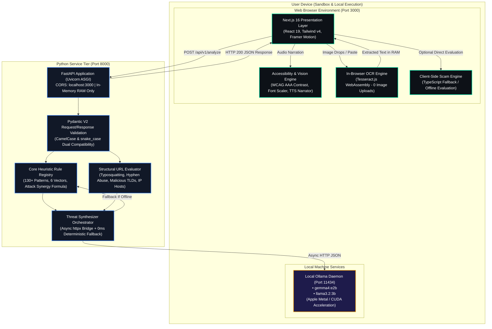
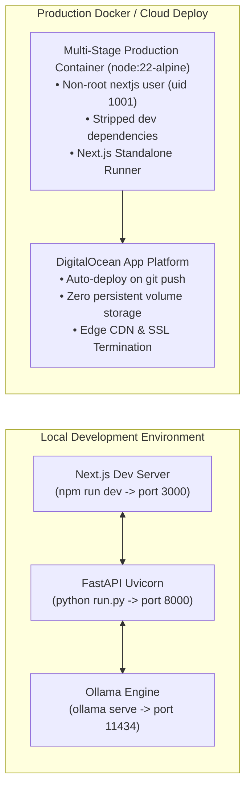

# 🏗️ ScamShield OSS — System Architecture Documentation

[](#core-architectural-principle-asymmetric-hybrid-engine)
[](#1-frontend-presentation-tier)
[](#2-backend-service-tier-fastapi)
[](#4-aiml-inference-tier)
[](#3-data-persistence-tier-zero-database-by-design)

---

## 📌 Executive Architectural Summary

**ScamShield OSS** is an open-source, privacy-preserving cyber fraud intelligence platform designed to analyze suspicious messages, phishing URLs, and chat screenshots without exposing sensitive user communications to third-party cloud infrastructure.

The platform employs a **stateless, dual-engine asymmetric hybrid architecture**:
1. **Deterministic Heuristic Rule Engine (0ms)**: Instantaneous, mathematical risk scoring executing in local memory (RAM) via strict regex pattern matching, structural URL inspection, and Bayesian probability compounding.
2. **Local AI Threat Synthesizer**: Connects to an on-device **Ollama** server (`gemma4:e2b`, `llama3.2`) via async HTTP to generate natural-language threat breakdowns, psychological manipulation analyses, and actionable protective measures.
3. **Zero-Database, Ephemeral Memory Lifecycle**: The platform contains no database, no user accounts, no cookies, and no persistent disk logging. All state is cleared when the browser tab is closed or the HTTP response completes.

---

## 🏛️ High-Level System Architecture



---

## 🔄 End-to-End Threat Processing Pipeline

The following sequence diagram details the end-to-end lifecycle of an analysis request from input ingestion to UI display:

```mermaid
sequenceDiagram
    autonumber
    actor User as User / Analyst
    participant Browser as Next.js 16 UI
    participant Wasm as Tesseract.js (Wasm)
    participant API as FastAPI Backend (/api/v1/analyze)
    participant Heuristic as Heuristic Engine (Python/TS)
    participant Ollama as Local Ollama (localhost:11434)

    alt Screenshot Scanning
        User->>Browser: Upload or paste image (Ctrl+V)
        Browser->>Wasm: Process image in browser sandbox
        Note over Wasm: Image never leaves device RAM
        Wasm-->>Browser: Extracted text tokens
    else Message or URL Scanning
        User->>Browser: Submit raw SMS, email, or URL string
    end

    Browser->>API: POST /api/v1/analyze { text, type, model }
    Note over API: In-Memory Pydantic V2 validation

    API->>Heuristic: evaluate_scam(text, type)
    Note over Heuristic: 1. Evaluate 6 threat categories<br/>2. Analyze URL structure & TLD<br/>3. Compute Bayesian probability<br/>4. Apply attack synergy factor
    Heuristic-->>API: { riskScore, riskLevel, indicators, categoryScores }

    alt Ollama Service Reachable
        API->>Ollama: POST /api/chat { model, prompt, format: "json" }
        Ollama-->>API: JSON: { summary, psychologicalTrigger, actionItems }
    else Ollama Offline / Timeout
        API->>Heuristic: generate_deterministic_explanation()
        Note over Heuristic: 0ms mathematical threat synthesis
        Heuristic-->>API: Structured fallback explanation
    end

    API-->>Browser: HTTP 200 { riskScore, indicators, explanation, ... }
    Note over API: Request terminates; RAM garbage collected

    Browser->>User: Render SecurityDashboardResult (Animated Radar Gauge, Indicators, Audio TTS)
```

---

## 🧩 Detailed Component Architecture

### 1. Frontend Presentation Tier
* **Framework**: Next.js 16 (App Router), React 19.
* **Styling & Design System**: Tailwind CSS v4, Vanilla CSS variables, Glassmorphism, Halftone LED canvas background.
* **Animation Engine**: Framer Motion for micro-interactions, layout transitions, radar scanlines, and pulse rings.
* **Client-Side Optical Character Recognition (OCR)**:
  - Powered by **Tesseract.js** running in a browser **WebAssembly (Wasm)** worker.
  - Screenshots are processed entirely within the user's browser thread.
  - Zero bytes of image data are ever uploaded or transmitted across the network.
* **Accessibility & Universal Design Engine (WCAG 2.2 AAA)**:
  - Dynamic 4-step root font scaling (`data-text-scale`: 100% to 162.5%).
  - WCAG AAA High Contrast Dark (`#000000` canvas, yellow/white text, 2px solid borders, >=7:1 contrast).
  - WCAG AAA High Contrast Light (`#ffffff` canvas, pitch-black text, 2px borders).
  - Dyslexia-safe typography mode (`data-dyslexia`: enhanced letter-spacing, line-height 1.85).
  - Reduced Motion toggle (`data-reduced-motion`: disables scanlines, radar sweeps).
  - Built-in Voice Threat Readout via the Web Speech API (`SpeechSynthesis`).

---

### 2. Backend Service Tier (FastAPI)
* **Framework**: FastAPI (ASGI) running on Python 3.9+ with Uvicorn.
* **Contract Validation**: Pydantic V2 (`BaseModel` with `populate_by_name=True` and `alias_generator=to_camel`) ensuring 100% cross-compatibility with JavaScript camelCase payloads.
* **Routing Structure**:
  - `GET /` — Service metadata and documentation links.
  - `GET /api/v1/health` — Service health and local Ollama model detection.
  - `POST /api/v1/analyze` — Unified threat detection pipeline.
  - `POST /api/v1/explain` (and legacy `/api/explain`) — Drop-in replacement for Next.js AI synthesis.
* **Networking**: Asynchronous non-blocking HTTP requests via `httpx.AsyncClient` with bounded timeouts (1.5s for model discovery, 20s for inference).
* **Cross-Origin Resource Sharing (CORS)**: Preconfigured for `http://localhost:3000`, `http://127.0.0.1:3000`, and customizable via environment variables.

---

### 3. Data Persistence Tier: Zero-Database by Design
ScamShield explicitly eliminates the data persistence layer:
* **No Database Engines**: Zero SQL, NoSQL, or Key-Value stores (No PostgreSQL, MySQL, SQLite, MongoDB, Firebase, Redis).
* **No User Accounts or Authentication**: Zero registration, login, JWT cookies, sessions, or user trackers.
* **No Disk Message Logs**: Incoming texts are held in volatile process memory during execution and discarded immediately after HTTP response delivery.
* **Architectural Rationale**: Prevents data breach exposure, surveillance liability, compliance overhead (GDPR / CCPA / HIPAA), and protects whistleblower or victim confidentiality.

---

### 4. AI/ML Inference Tier
ScamShield uses an asymmetric approach where AI never calculates raw risk numbers, eliminating LLM hallucination in quantitative scoring:

```
[ Quantitative Threat Math ] ──► Handled by Deterministic Heuristic Engine (0ms, 100% predictable)
[ Qualitative Threat Synthesis ] ──► Handled by Local Ollama (gemma4:e2b / llama3.2)
[ Offline / Zero-Setup Fallback ] ──► Handled by Deterministic Natural-Language Templates
```

#### A. Local Ollama Integration (`http://localhost:11434`)
* Direct on-device inference using locally pulled weights (`gemma4:e2b`, `llama3.2:3b`, `mistral`, etc.).
* Operates offline; zero network data leaves the local workstation.
* Responses are forced into strict JSON schema:
  ```json
  {
    "summary": "Crisp 2-sentence executive breakdown",
    "psychologicalTrigger": "Identified cognitive manipulation technique",
    "actionItems": ["Defensive action 1", "Defensive action 2", "Defensive action 3"]
  }
  ```

#### B. Deterministic Natural-Language Fallback
* If Ollama is offline or uninstalled, the fallback engine immediately synthesizes an authoritative threat breakdown based on the triggered rule metadata.
* Guarantees 0ms latency and 100% system availability under all operating conditions.

---

## 🧮 Mathematical Threat Compounding Model

### 1. Individual Heuristic Vectors
Rules belong to 6 threat categories, each calibrated with a probabilistic weight $p_i \in [0.10, 0.45]$:

| Vector | Category ID | Example Indicators | Prob. Weight ($p_i$) |
| :--- | :--- | :--- | :--- |
| **Urgency** | `urgency` | "Within 24 hours", "Account suspended", "Click now" | 0.30 – 0.34 |
| **Financial** | `financial` | "Deposit fee", "Wire transfer", "Crypto", "USDT" | 0.36 |
| **Impersonation**| `impersonation` | Fake SBI, HDFC, Netflix, Amazon, India Post | 0.35 – 0.42 |
| **Credentials** | `credentials` | "Share OTP", "CVV", "Netbanking password", "KYC" | 0.22 – 0.38 |
| **Technical** | `technical` | Hyphen abuse, `.xyz`/`.top` TLD, naked IP host | 0.18 – 0.40 |
| **Bait** | `bait` | "Won ₹50,000", "YouTube like task", "Daily income" | 0.35 – 0.40 |

### 2. Asymptotic Compounding Formula
Combined risk probability is calculated using survival probability multiplication:

$$P_{\text{threat}} = 1 - \prod_{i=1}^{n} (1 - \text{clamp}(p_i, 0.08, 0.85))$$

### 3. Multi-Category Attack Synergy Factor
When multiple distinct threat categories align, real-world danger compounds exponentially. The engine applies an attack synergy bonus:

$$\text{Synergy Adjustment} = \begin{cases} 
+0.09 & \text{if active categories} \ge 4 \\
+0.06 & \text{if active categories} = 3 \\
+0.03 & \text{if active categories} = 2 \\
0 & \text{otherwise}
\end{cases}$$

### 4. Calibrated Score Tiers
The final score is clamped between 22% and 96% for detected threats, mapping to five discrete threat tiers:
* **80% – 100%**: `CRITICAL_THREAT` (Severe active danger; credentials or funds targeted)
* **60% – 79%**: `HIGH_RISK` (High probability scam; deceptive lures present)
* **35% – 59%**: `SUSPICIOUS` (Caution advised; irregular urgency or unverified domains)
* **18% – 34%**: `LOW_RISK` (Minor warnings; isolated pressure words)
* **0% – 17%**: `SAFE` (Ambient baseline for clean communications with authentic domains)

---

## 📁 Repository Directory Structure

```
ScamShield-oss-main/
├── backend/                       # Python FastAPI Backend Service
│   ├── app/
│   │   ├── __init__.py            # Application package descriptor
│   │   ├── main.py                # FastAPI initialization, CORS, and route mounting
│   │   ├── config.py              # Environment settings (Pydantic BaseSettings)
│   │   ├── schemas/               # Data contracts (Pydantic V2)
│   │   │   ├── __init__.py
│   │   │   ├── analysis.py        # AnalyzeRequest, AnalyzeResponse, DetectedIndicator
│   │   │   └── explanation.py     # ExplainRequest, ExplainResponse
│   │   ├── core/                  # Core Heuristic & Mathematical Detection
│   │   │   ├── __init__.py
│   │   │   ├── rules.py           # Message heuristic rule registry (8 core vectors)
│   │   │   ├── url_analyzer.py    # Domain parsing, typosquatting, and TLD checks
│   │   │   ├── fallback_engine.py # 0ms deterministic psychological trap generator
│   │   │   └── engine.py          # Unified analyzer & Bayesian scoring logic
│   │   ├── services/              # External Integrations
│   │   │   ├── __init__.py
│   │   │   ├── ollama_client.py   # Async HTTP client for local Ollama (port 11434)
│   │   │   └── threat_synthesizer.py # Orchestrator for LLM + fallback synthesis
│   │   └── api/v1/                # REST API Endpoints
│   │       ├── __init__.py
│   │       ├── router.py          # Route aggregator
│   │       ├── health.py          # GET /health & local model discovery
│   │       ├── analyze.py         # POST /analyze
│   │       └── explain.py         # POST /explain
│   ├── tests/                     # Test Suite
│   │   ├── __init__.py
│   │   ├── test_scam_engine.py    # Benchmark verification tests (mirrors test-cli.mjs)
│   │   └── test_api.py            # FastAPI endpoint integration tests
│   ├── requirements.txt           # Pinned production Python dependencies
│   ├── run.py                     # Development launcher (uvicorn)
│   ├── .env.example               # Template environment configuration
│   └── README.md                  # Dedicated backend documentation
├── src/                           # Next.js 16 Frontend Codebase
│   ├── app/
│   │   ├── api/explain/route.ts   # Next.js route handler for local AI synthesis
│   │   ├── globals.css            # Tailwind v4, themes, and WCAG AAA accessibility
│   │   ├── layout.tsx             # Root layout with accessibility providers
│   │   └── page.tsx               # Primary dashboard interface
│   ├── components/                # Reusable UI Component Library
│   │   ├── AnalysisCard.tsx       # Multi-scanner input tabs (Message, URL, OCR)
│   │   ├── SecurityDashboardResult.tsx # Risk gauge, breakdown, and action items
│   │   ├── HeroSection.tsx        # Hero banner with halftone LED background
│   │   ├── Navbar.tsx             # Navigation bar with accessibility toggles
│   │   ├── FeatureSection.tsx     # Security architecture feature highlights
│   │   ├── DemoSection.tsx        # 1-Click test presets for hackathon judges
│   │   ├── HowItWorksSection.tsx  # Step-by-step visual explanation
│   │   ├── OpenSourceSection.tsx  # Open source commitment & GitHub links
│   │   ├── Footer.tsx             # Clean minimal footer
│   │   └── AdvancedSettingsModal.tsx # Model selector & accessibility settings
│   └── lib/
│       ├── scamEngine.ts          # Client-side deterministic heuristic engine
│       ├── audio.ts               # Sound effects & SpeechSynthesis voice narrator
│       └── utils.ts               # Tailwind class merge utilities
├── public/                        # Static Assets (Images, Icons, Halftone LED bg)
│   ├── halftone-led-bg.jpg        # 4K Halftone LED wave hero background
│   ├── scamshield-icon.png        # Official brand iconography
│   └── scamshield-logo.png        # Official brand wordmark
├── .do/
│   └── app.yaml                   # DigitalOcean App Platform deployment spec
├── Dockerfile                     # Multi-stage production container build
├── test-cli.mjs                   # Node.js CLI benchmark verification runner
├── requirements.txt               # Repository-level Python requirements alias
├── package.json                   # Node.js dependencies and build scripts
├── PRIVACY.md                     # Zero-log privacy architectural guarantee
├── PRD.md                         # Product Requirements Document
├── DESIGN.md                      # Design System & Accessibility Specification
├── ROADMAP.md                     # 5-Phase Project Evolution Roadmap
└── README.md                      # Main project presentation & guide
```

---

## 🚀 Deployment & Infrastructure Architecture



### 1. Multi-Stage Docker Build
The provided [`Dockerfile`](Dockerfile) uses a 3-stage build (`deps` -> `builder` -> `runner`) based on `node:22-alpine`:
* **Non-root Execution**: Runs under a dedicated `nextjs:nodejs` system account (UID 1001).
* **Minimal Attack Surface**: Dev dependencies, TypeScript compilers, and build caches are purged in the final image.
* **Hermetic & Air-Gapped**: Can be built and operated in isolated enterprise intranets with zero external internet dependencies.

### 2. DigitalOcean App Platform (`.do/app.yaml`)
Configured for automated continuous deployment from the `main` branch with automatic HTTPS provisioning, zero disk volumes, and horizontal autoscaling support.
