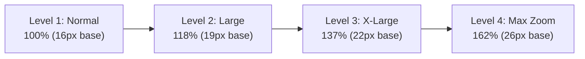

# 🎨 ScamShield OSS — Design System & UI/UX Specification

[](#6-accessibility-design--wcag-22-aaa-suite)
[](#1-design-philosophy--brand-identity)
[](#2-color-architecture--palette)

---

## 1. Design Philosophy & Brand Identity

ScamShield OSS delivers an **authoritative, high-density, privacy-first cybersecurity aesthetic** blending cyberpunk-inspired futuristic elements with clean, modern minimalism.

### Core Principles
1. **Empathetic Universal Accessibility**: Cybersecurity interfaces are typically built for tech-savvy engineers, leaving vulnerable seniors and neurodiverse individuals exposed. ScamShield elevates accessibility to a first-class aesthetic through high-contrast modes, dynamic magnification, and voice narration.
2. **Transparent Explainability**: Avoid opaque "AI black box" scores. Every threat rating is visually justified with detected pattern badges, matched text snippets, and quantifiable probability impacts.
3. **Calm Authority Under Threat**: High-risk alerts must communicate urgency without inducing debilitating panic. We pair bold severity indicators with calm, clear, numbered defensive actions.

---

## 2. Color Architecture & Palette

### 2.1 Default Dark Canvas (Luxury Tech Startup)
The default dark theme uses deep obsidian blacks, fine glassmorphism, and neon emerald highlights:

| Token | Hex Value | Semantic Role & Usage |
| :--- | :--- | :--- |
| `--bg-dark` | `#050505` | Master viewport canvas background |
| `--surface-dark` | `#111827` | Primary card surfaces, modal wrappers, tab bars |
| `--surface-glass` | `rgba(12, 15, 23, 0.85)` | Glassmorphic floating panels with `backdrop-filter: blur(20px)` |
| `--accent-primary` | `#00E5A8` | Brand signature neon emerald (Primary CTAs, active indicators, gauges) |
| `--accent-hover` | `#00c993` | Hover state for primary action buttons |
| `--border-subtle` | `rgba(255, 255, 255, 0.08)` | Refined 1px panel borders |
| `--border-glow` | `rgba(0, 229, 168, 0.35)` | Box-shadow glow for active focus and primary buttons |
| `--text-primary` | `#FFFFFF` | Primary headlines and high-emphasis labels |
| `--text-secondary`| `#A1A1AA` | Body copy, descriptions, and helper text |
| `--text-muted` | `#71717A` | Metadata, character counters, timestamps |

### 2.2 Threat Classification Color System
Visual indicators strictly adhere to standardized severity semantics:

| Threat Level | Primary Color | Background Tint | Border Stroke |
| :--- | :--- | :--- | :--- |
| **Critical Threat (80–100%)** | `#FF4D4D` (Neon Red) | `rgba(255, 77, 77, 0.12)` | `rgba(255, 77, 77, 0.35)` |
| **High Scam Risk (60–79%)** | `#F97316` (Vibrant Orange) | `rgba(249, 115, 22, 0.12)` | `rgba(249, 115, 22, 0.35)` |
| **Suspicious (35–59%)** | `#F59E0B` (Amber Gold) | `rgba(245, 158, 11, 0.12)` | `rgba(245, 158, 11, 0.35)` |
| **Low Risk (18–34%)** | `#06B6D4` (Electric Cyan) | `rgba(6, 182, 212, 0.12)` | `rgba(6, 182, 212, 0.35)` |
| **Safe / Clean (0–17%)** | `#10B981` (Emerald Green) | `rgba(16, 185, 129, 0.12)` | `rgba(16, 185, 129, 0.35)` |

### 2.3 Accessibility Palettes (WCAG AAA >= 7:1)
* **High Contrast Dark (`data-contrast="high-dark"`)**:
  - Background: Pure Pitch-Black (`#000000`).
  - Text & Icons: High-Visibility Neon Yellow (`#FFFF00`) and Crisp White (`#FFFFFF`).
  - Borders: 2px solid `#FFFFFF` or `#FFFF00`.
  - Contrast Ratio: **> 19:1** against black.
* **High Contrast Light (`data-contrast="high-light"`)**:
  - Background: Stark Pure White (`#FFFFFF`).
  - Text & Icons: Pitch-Black (`#000000`).
  - Borders: 2px solid `#000000`.
  - Contrast Ratio: **21:1** maximum contrast.

---

## 3. Typography & Root Font Scaling

### 3.1 Typeface Families
* **Primary Sans**: `Inter`, `-apple-system`, `BlinkMacSystemFont`, `"Segoe UI"`, `Roboto`, sans-serif.
* **Monospace & Telemetry**: `"JetBrains Mono"`, `"Fira Code"`, `ui-monospace`, monospace (used for risk percentages, model tags, and code tokens).
* **Dyslexia Safe Stack**: `Arial`, `"Helvetica Neue"`, sans-serif with expanded tracking (`0.08em`), word-spacing (`0.16em`), and line-height (`1.85`).

### 3.2 Dynamic Root Font Scaling (Text Magnifier)
Rather than hardcoding pixel dimensions, all UI elements utilize Tailwind `rem` units tied to the root `<html>` font size. The user-selectable magnifier scales the entire layout seamlessly:



---

## 4. Visual Background Architecture: Halftone LED Wave

The top hero viewport features an **edge-to-edge futuristic Halftone LED Display** background ([`public/halftone-led-bg.jpg`](public/halftone-led-bg.jpg)):

```
┌─────────────────────────────────────────────────────────────┐
│  [ Halftone LED Wave Display: 4K Organic Dot Matrix ]       │
│  - Thousands of glowing, luminous micro-LED dots            │
│  - Cool cyan, silver, and ethereal white light blooms       │
│  - Cinematic depth-of-field and volumetric lighting         │
│  - Multilayered edge vignettes melting into #050505 canvas  │
│                                                             │
│  [ Foreground Content Layer (z-index: 10) ]                 │
│  - Startup Navbar                                           │
│  - HeroSection (Headline, Subheadline, Primary CTAs)        │
│  - AnalysisCard Glassmorphic Workspace                      │
└─────────────────────────────────────────────────────────────┘
```

* **Accessibility Safety**: Automatically disabled in WCAG AAA High Contrast modes via CSS (`.halftone-led-layer { display: none !important; }`).

---

## 5. UI Component Hierarchy & Specifications

```mermaid
graph TD
    RootPage["ScamShieldHome (page.tsx)"]
    RootPage --> HalftoneBG["Halftone LED Hero Layer (public/halftone-led-bg.jpg)"]
    RootPage --> NavbarComp["Navbar (Logo, Accessibility Quick Drawer, Model Badge)"]
    RootPage --> HeroComp["HeroSection (Headline, Call-to-Actions, Live Badge)"]
    RootPage --> PresetBar["DemoSection (Hackathon 1-Click Test Scenarios)"]
    RootPage --> MainCard["AnalysisCard (Input Tabs, Paste Dropzone, Scan Button)"]
    RootPage --> ResultDash["SecurityDashboardResult (Appears on Scan)"]
    ResultDash --> RadarGauge["Animated Radar Threat Gauge (0 - 100%)"]
    ResultDash --> ThreatBanner["Severity Status Banner"]
    ResultDash --> IndList["Detected Heuristic Indicators (Impact Badges)"]
    ResultDash --> AISynthesis["Local AI Executive Threat Breakdown"]
    ResultDash --> ActionList["3 Defensive Action Items"]
    ResultDash --> VoiceTTS["Voice Threat Readout (SpeechSynthesis Narrator)"]
    RootPage --> Features["FeatureSection (Architecture Highlights)"]
    RootPage --> HowItWorks["HowItWorksSection (3-Step Diagram)"]
    RootPage --> OpenSource["OpenSourceSection (GitHub, MIT License)"]
    RootPage --> FooterComp["Footer"]
    RootPage --> SettingsModal["AdvancedSettingsModal (Model Selector, OCR Lang)"]
```



### 5.1 Component Details
1. **AnalysisCard (`src/components/AnalysisCard.tsx`)**:
   - Tab switchers with smooth animated active pills (Framer Motion `layoutId`).
   - Integrated clipboard paste listener (`window.addEventListener('paste')`).
   - Real-time character counter and 1-click synthetic sample loader.
2. **SecurityDashboardResult (`src/components/SecurityDashboardResult.tsx`)**:
   - Circular SVG gauge with animated conic gradient sweeps.
   - Distinct color-coded severity headers (`CRITICAL_THREAT`, `HIGH_RISK`, `SUSPICIOUS`, etc.).
   - Expandable indicator chips with rule IDs and probability impact metrics.
   - Built-in Voice Readout toggle with audio feedback.

---

## 6. Accessibility Design — WCAG 2.2 AAA Suite

ScamShield implements a dedicated **Vision Suite** exceeding standard web compliance:

```
┌─────────────────────────────────────────────────────────────┐
│             ♿ SCAMSHIELD VISION & ACCESSIBILITY SUITE        │
├─────────────────────────┬───────────────────────────────────┤
│ 1. Text Magnifier       │ 4-level root font scaling         │
│                         │ (100% -> 118% -> 137% -> 162%)    │
├─────────────────────────┼───────────────────────────────────┤
│ 2. High Contrast Dark   │ Pure black (#000000), 2px white   │
│                         │ borders, #FFFF00 yellow text      │
├─────────────────────────┼───────────────────────────────────┤
│ 3. High Contrast Light  │ Pure white (#FFFFFF), 2px black   │
│                         │ borders, pitch-black typography   │
├─────────────────────────┼───────────────────────────────────┤
│ 4. Dyslexia Readability │ Arial stack, 0.08em letter space, │
│                         │ 0.16em word space, line-height 1.85│
├─────────────────────────┼───────────────────────────────────┤
│ 5. Reduced Motion       │ Complete elimination of radar     │
│                         │ sweeps, scanlines, and pulses     │
├─────────────────────────┼───────────────────────────────────┤
│ 6. Voice Audio Readout  │ Built-in Web Speech API narrator  │
│                         │ with instant threat vocalization  │
└─────────────────────────┴───────────────────────────────────┘
```

---

## 7. Motion & Animation Standards

* **Radar Scanline Sweep**: Used during active analysis to provide visual feedback:
  ```css
  @keyframes scanline {
    0% { transform: translateY(-100%); }
    100% { transform: translateY(1000%); }
  }
  ```
* **Radar Pulse Gauge**: Smooth ambient breathing effect on the circular risk meter:
  ```css
  @keyframes radar-pulse {
    0%, 100% { transform: scale(0.95); opacity: 0.8; }
    50% { transform: scale(1.05); opacity: 0.4; }
  }
  ```
* **Reduced Motion Compliance**: Whenever `@media (prefers-reduced-motion: reduce)` or `html[data-reduced-motion="true"]` is active, all animation durations collapse to `0.001ms`.
