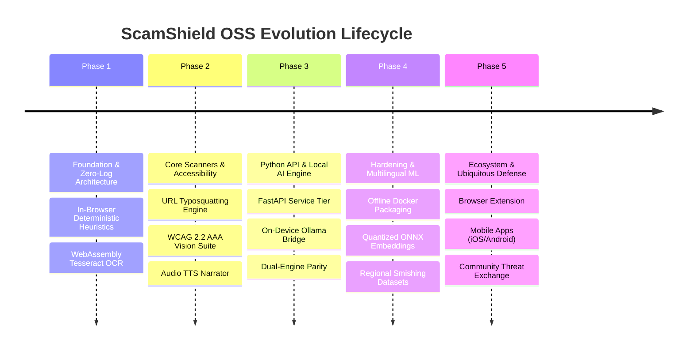

# 🗺️ ScamShield OSS — Strategic Evolution Roadmap

---

## Overview of Phases

---

## 📍 Phase Breakdown & Deliverables

### Phase 1: Foundation & Zero-Log Core (Completed ✅)
* **Goal**: Establish the fundamental architectural guarantee of zero-database, client-side threat detection.
* **Deliverables**:
  - [x] Initial Next.js 16 App Router interface with Obsidian Black theme.
  - [x] Core regex heuristic scanner covering Urgency, Call-to-Action Bait, and Lottery Lures.
  - [x] In-browser WebAssembly OCR integration using **Tesseract.js** (zero image bytes sent to any server).
  - [x] Ephemeral in-memory execution pipeline guaranteed by [`PRIVACY.md`](PRIVACY.md).
  - [x] Hackathon interactive preset bar with 5 calibrated demo scenarios.

---

### Phase 2: Multi-Vector Scanners & Universal Accessibility (Completed ✅)
* **Goal**: Expand scanner capabilities across URLs and implement world-class accessibility for vulnerable populations.
* **Deliverables**:
  - [x] Deep structural URL parser (hyphen stuffing, numeric subdomains, brand impersonation, high-risk TLD filtering).
  - [x] Mathematical score compounding with Bayesian survival probability formulas.
  - [x] Multi-category attack synergy factor boosting risk when $\ge 2$ threat categories align.
  - [x] **WCAG 2.2 AAA Accessibility Suite**:
    - [x] Dynamic 4-step root font magnification (100% to 162%).
    - [x] High Contrast Dark (AAA >= 7:1) with yellow/white typography and solid borders.
    - [x] High Contrast Light (AAA >= 7:1) with pure white canvas and pitch-black text.
    - [x] Dyslexia-safe typography mode.
    - [x] Vestibular safety mode (`prefers-reduced-motion`).
    - [x] Built-in Web Speech API voice narrator reading threat summaries aloud.
  - [x] Calibrated Node.js CLI verification suite (`test-cli.mjs`) ensuring 100% benchmark fidelity.

---

### Phase 3: Dual-Engine Python API & Local AI Inference (Completed ✅)
* **Goal**: Introduce a decoupled Python backend service with local LLM threat synthesis for multi-platform integration.
* **Deliverables**:
  - [x] High-performance **FastAPI** backend service with asynchronous non-blocking routing.
  - [x] Strict Pydantic V2 request and response contracts with bidirectional camelCase / snake_case serialization.
  - [x] 100% On-Device **Ollama** integration (`http://localhost:11434`) querying open weights (`gemma4:e2b`, `llama3.2`).
  - [x] 0ms Deterministic Natural-Language fallback engine activating when Ollama is offline.
  - [x] Interactive OpenAPI Swagger documentation at [`http://localhost:8000/docs`](http://localhost:8000/docs).
  - [x] Python test suite (`tests/test_scam_engine.py` & `test_api.py`) passing with 100% benchmark score parity.
  - [x] Futuristic 4K Halftone LED Display hero background with volumetric depth vignettes.

---

### Phase 4: Hardening, Multilingual Support & Local ML (In Progress 🚧 — Q1 2027)
* **Goal**: Enhance detection accuracy with lightweight local ML models and support regional language smishing.
* **Target Milestones**:
  - [ ] **Quantized Local ML Embedding Classifier**:
    - Integrate local ONNX runtime or `sentence-transformers` for semantic vector similarity against known fraud templates.
    - Runs 100% on CPU without requiring an external GPU.
  - [ ] **Multilingual Smishing Taxonomies**:
    - Extend heuristic rules to detect regional fraud vectors in Hindi, Spanish, French, and Portuguese.
    - Multi-language OCR recognition support in Tesseract.js Wasm.
  - [ ] **Automated Rule Customizer**:
    - Allow enterprise security teams to define custom YAML regex rules without touching code.
  - [ ] **Self-Contained Offline Docker Bundle**:
    - Single Docker compose file packaging Next.js frontend, FastAPI backend, and pre-pulled Ollama weights for 100% air-gapped deployment.

---

### Phase 5: Ecosystem Expansion & Ubiquitous Defense (Planned 🔮 — Q2 2027)
* **Goal**: Protect users proactively at the point of interaction across browsers, messaging apps, and mobile devices.
* **Target Milestones**:
  - [ ] **Cross-Browser Extension (Chrome, Firefox, Safari)**:
    - Real-time page scanning for phishing URLs and deceptive login forms.
    - Right-click context menu: "Scan highlighted text with ScamShield".
  - [ ] **Native Mobile Clients (iOS & Android)**:
    - Built with Flutter or React Native connecting directly to the local/self-hosted Python API.
    - System Share Sheet integration: share screenshots directly from WhatsApp/Telegram into ScamShield.
  - [ ] **Privacy-Preserving Federated Threat Feed**:
    - Zero-knowledge cryptographic hashing of confirmed malicious domains to update open-source blocklists without exposing reporter identities.
  - [ ] **Community Plugin Marketplace**:
    - Community-contributed fraud heuristics for emerging scams (e.g., AI voice cloning indicators, deepfake video verification hooks).

---

## 📊 Phase Deliverables Summary Matrix

| Capability | Phase 1 (Foundation) | Phase 2 (Core) | Phase 3 (Python API) | Phase 4 (ML & Hardening) | Phase 5 (Ecosystem) |
| :--- | :---: | :---: | :---: | :---: | :---: |
| **Deterministic Rules** | Basic (3 Vectors) | Advanced (6 Vectors) | Dual TS/Python Parity | YAML Custom Rules | Federated Sync |
| **URL Analysis** | ❌ | Regex & TLD Checks | Python URL Parser | WHOIS & DNS Checks | Real-Time Extension |
| **Screenshot OCR** | Client Wasm | Client Wasm | Client Wasm | Multi-Language Wasm | Mobile Camera OCR |
| **AI Threat Synthesis**| ❌ | ❌ | Local Ollama + Fallback | Local ONNX Embedding | Distributed Cloud/Local |
| **Accessibility Suite** | Basic Contrast | WCAG AAA Suite + TTS | WCAG AAA Preserved | Accessible Mobile UI | Screen Reader Certified |
| **Backend API** | Next.js Internal | Next.js Internal | FastAPI REST API | Quantized ONNX Runner | Distributed Microservices |
| **Data Retention** | **0 Database** | **0 Database** | **0 Database** | **0 Database** | **0 Database** |
